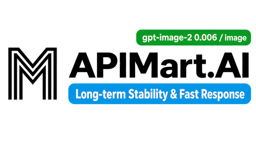
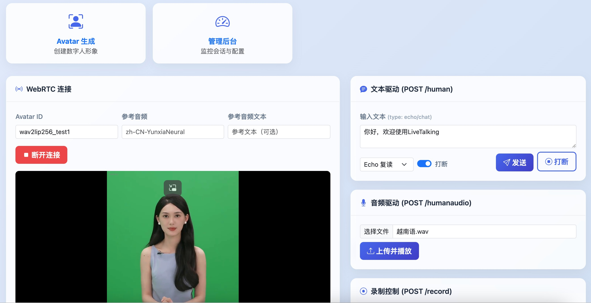
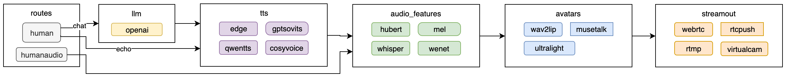

<p align="center">
    
</p>

[English](./README-EN.md) | [中文版](./README.md) | 日本語

<p align="center">
    <a href="./LICENSE"></a>
    <a href="https://github.com/lipku/LiveTalking/releases"></a>
    <a href=""></a>
    <a href=""></a>
    <a href="https://github.com/lipku/LiveTalking/graphs/contributors"></a>
</p>
<p align="center">
<a href="https://trendshift.io/repositories/12565" target="_blank"></a>
</p>

音声と映像を同期させた会話を実現する、リアルタイムでインタラクティブなストリーミング型デジタルヒューマンエンジンです。商用アプリケーションで広く採用されています。

**デモ**: [wav2lip](https://youtu.be/-ss0H8qLr7E) | [ernerf](https://www.bilibili.com/video/BV1G1421z73r/) | [musetalk](https://youtu.be/vzUMruoZlxc/)

国内ミラー: [Gitee](https://gitee.com/lipku/LiveTalking) | [GitCode](https://gitcode.com/lipku/LiveTalking)

## ❤️スポンサー

> [ここに掲載しませんか？](mailto:lipku@foxmail.com)

<details open>
<summary>クリックして折りたたむ</summary>
<table>
<tr>
<td width="180"><a href="https://www.packyapi.ai/register?aff=4gqz"></a></td>
<td>PackyCode を通じて、1 つの API エンドポイントと 1 つの API キーで主要な AI モデルにアクセスできます。自動フェイルオーバーと、Codex と Claude Code 専用の高速ルートによる、速くて信頼性の高いアクセスをお楽しみください。
$1 分の無料クレジット、初回チャージの割引、対象ルートでの最大 80% の節約から始められます。<a href="https://www.packyapi.ai/register?aff=4gqz">リンク</a>から登録してください</td>
</tr>
<tr>
<td width="180"><a href="https://go.apimart.ai/tw-livetalking"></a></td>
<td>APIMart は、AI による画像と動画の生成のための低価格な API プラットフォームです。GPT-Image-2 は 1 枚 $0.006 から、1 ドルで 160 枚以上の画像を生成できます。1 つの非同期 API で画像と動画の両方に対応しています。タスクを送信して ID を受け取り、ポーリングまたはコールバックで結果を取得します。タイムアウトなしで数万枚の画像をバッチ処理でき、コードを変えずにモデルを切り替えられます。月額料金なしの従量課金です。<a href="https://go.apimart.ai/tw-livetalking">こちら</a>から登録して始めましょう。</td>
</tr>
</table>

</details>

---

## 特徴
1. 複数のデジタルヒューマンモデルに対応：ernerf、musetalk、wav2lip、Ultralight-Digital-Human
2. 音声クローンに対応
3. デジタルヒューマンの発話中の割り込みに対応
4. 全身動画の合成に対応
5. WebRTC、RTMP、仮想カメラへの出力に対応
6. 動作の振り付けに対応：発話していないときにカスタム動画を再生
7. 複数の同時接続に対応
8. カスタムのデジタルヒューマンアバターに対応
9. フロントエンド向けの API 連携を提供

---

## 利用シーン

LiveTalking は、リアルタイムストリーミングのデジタルヒューマン技術を活用し、テキストや音声でバーチャルアバターを動かし、LLM と組み合わせてインテリジェントな会話を実現します。次のようなシーンに適しています。

| シーン | 説明 |
|----------|-------------|
| **バーチャル配信者 / ライブコマース [LiveStream](https://github.com/lipku/livestream)** | LLM が生成するセールストークと動作の振り付けによる自然なパフォーマンスで、24 時間 365 日の無人ライブ配信 |
| **AI デジタルヒューマンによるカスタマーサービス** | 企業のナレッジベースと連携し、割り込みに対応したリアルタイムの音声 Q&A |
| **オンライン教育 / 研修** | 講座収録のためのデジタル教師の分身、または API で動かすリアルタイム講義のデジタル講師 |
| **インテリジェント音声アシスタント** | スマートスピーカーやアプリと組み合わせ、`/human` API を呼び出してデジタルヒューマンの音声対話を駆動 |
| **大画面でのプレゼンテーション** | 展示ホール、イベント会場などでコンテンツを解説するデジタルヒューマンのプレゼンター |
| **ショート動画の一括作成** | `/human` + `/record` API を使い、API で台本を一括送信して、実写の撮影なしでデジタルヒューマンの動画を生成 |

**コアフロー**: ユーザー入力（テキスト / 音声）→ LLM の応答（任意）→ TTS による音声合成 → リアルタイムのリップシンク → 音声 / 映像のストリーミング出力

---

## 1. インストール

Ubuntu 24.04、Python 3.12、PyTorch 2.9.1、CUDA 12.8 でテストしています。

### 1.1 依存関係のインストール

```bash
git clone https://github.com/lipku/LiveTalking.git 
conda create -n livetalking python=3.12
conda activate livetalking
# If CUDA version is not 12.8 (check via nvidia-smi), install the corresponding PyTorch version(https://pytorch.org/get-started/previous-versions)
pip install torch==2.9.1 torchvision==0.24.1 torchaudio==2.9.1 --index-url https://download.pytorch.org/whl/cu128
cd LiveTalking
pip install -r requirements.txt
```

インストールの FAQ: <https://doc.livetalking.ai/en/docs/faq/>

Linux の CUDA 環境のセットアップ: <https://zhuanlan.zhihu.com/p/674972886>

---

## 2. クイックスタート

### 2.1 モデルのダウンロード

| 入手元 | リンク |
|--------|------|
| Quark Cloud | <https://pan.quark.cn/s/83a750323ef0> |
| Google Drive | <https://drive.google.com/drive/folders/1FOC_MD6wdogyyX_7V1d4NDIO7P9NlSAJ?usp=sharing> |

1. `wav2lip256.pth` をプロジェクトの `models/` ディレクトリにコピーし、`wav2lip.pth` に名前を変更します
2. `wav2lip256_avatar1.tar.gz` を展開し、展開したフォルダー全体を `data/avatars/` にコピーします

### 2.2 サーバーの起動

```bash
python app.py --transport webrtc --model wav2lip --avatar_id wav2lip256_avatar1
```

> **注意**: サーバーでは TCP:8010、UDP:1-65536 のポートを開放する必要があります

### 2.3 クライアントからのアクセス

| 方法 | 説明 |
|--------|-------------|
| ブラウザー | `http://serverip:8010/index.html` を開き、"Start Connection" をクリックしてデジタルヒューマンの映像を再生してから、テキストを入力して送信します |
| API | HTTP ベースの連携については [API ドキュメント](docs/api.md)をご覧ください |
| デスクトップアプリ | ダウンロード: <https://pan.quark.cn/s/d7192d8ac19b> |

### 2.4 Web ページ

| ページ | URL | 説明 |
|------|-----|-------------|
| ホーム | `/index.html` | WebRTC 接続 + テキスト / 音声による駆動 + 録画の制御 |
| アバター作成 | `/avatar.html` | 動画をアップロードしてデジタルヒューマンのアバターを自動生成 |
| 管理コンソール | `/admin.html` | セッションのリアルタイム監視とグローバル設定 |



### 2.5 すぐに試す

1. クラウドイメージでインスタンスを作成すると、すぐに実行できます: [UCloud のイメージ](https://www.compshare.cn/images/4458094e-a43d-45fe-9b57-de79253befe4?referral_code=3XW3852OBmnD089hMMrtuU&ytag=GPU_GitHub_livetalking)  
2. Windows 用の統合パッケージ <https://pan.quark.cn/s/a040bf5cb065>
3. 商用版のデモ URL <https://www.livetalking.top>

### 2.6 ドキュメント
<https://doc.livetalking.ai/en>

---

## 3. アーキテクチャ

### データフロー図



### レイヤーの概要

**API レイヤー**
- `/human`: テキストを受け付けます。echo（そのまま再生）と chat（LLM との会話）のモードに対応しています
- `/humanaudio`: 音声ファイルを受け付けて、そのまま再生します
- 各接続には一意の `sessionid` が割り当てられ、複数ユーザーの同時接続に対応しています

**ロジックレイヤー**
- **LLM エンジン**: Qwen などのモデルと連携して、会話の応答を生成します
- **TTS エンジン**: モジュール式の設計で、EdgeTTS、GPT-SoVITS、CosyVoice、Tencent Cloud などに対応しています
- **特徴量の抽出**: リップシンクの推論のために、音響特徴量（メルスペクトログラムなど）を同期して抽出します

**レンダリングレイヤー**
- **モデルの推論**: 深層学習モデル（Wav2Lip、MuseTalk など）を使い、音声の特徴量からリップシンクのフレームを生成します
- **後処理**: 生成した口元の領域を、元の高解像度の映像に滑らかに重ね合わせます

**ストリーミングレイヤー**
- **WebRTC**: ブラウザーでの低遅延のストリーミング
- **RTMP**: 標準的なライブ配信プロトコルで、Bilibili / YouTube などのプラットフォームへのプッシュに対応しています
- **仮想カメラ**: システムのカメラデバイスとして出力します

**プラグインシステム**
- [registry.py](registry.py) にもとづく分散型の登録メカニズムで、開発者は TTS、Avatar、Output のモジュールを拡張できます

---

## 4. API ドキュメント

| ドキュメント | 説明 |
|----------|-------------|
| [docs/api.md](docs/api.md) | 一般 API — WebRTC、テキスト / 音声による駆動、録画、動作の振り付け |
| [docs/avatar_api.md](docs/avatar_api.md) | アバター生成 API — タスクの作成、進捗の確認、タスクの削除 |
| [docs/admin_api.md](docs/admin_api.md) | 管理 API — グローバル設定、セッションの監視、強制停止 |

---

## 5. Docker

利用できるイメージ:
- **AutoDL**: [イメージ](https://www.codewithgpu.com/i/lipku/livetalking/base)  
- **UCloud**: [イメージ](https://www.compshare.cn/images/4458094e-a43d-45fe-9b57-de79253befe4?referral_code=3XW3852OBmnD089hMMrtuU&ytag=GPU_GitHub_livetalking) — 任意のポートの開放に対応しています  


---

## 6. パフォーマンス

- 映像ストリームの圧縮はそれぞれ CPU を消費し、解像度が高いほど CPU 使用率も大きくなります。リップシンクの推論はそれぞれ GPU を消費します
- 発話していないときの同時セッション数は CPU に、発話中の同時セッション数は GPU に依存します
- バックエンドのログでは、`inferfps` = GPU の推論フレームレート、`finalfps` = 最終的なストリーミングのフレームレートです。リアルタイムで動作させるには、どちらも >= 25 である必要があります

### リアルタイム推論のパフォーマンス

| モデル | GPU | FPS |
|:------|:----|:----|
| wav2lip256 | RTX 3060 | 60 |
| wav2lip256 | RTX 3080Ti | 120 |
| musetalk | RTX 3080Ti | 42 |
| musetalk | RTX 3090 | 45 |
| musetalk | RTX 4090 | 72 |

- wav2lip256: RTX 3060 以上を推奨
- musetalk: RTX 3080Ti 以上を推奨

---

## 7. 商用版
|項目|オープンソース版|商用版|
|---|---|---|
|位置づけ|オープンソースのコミュニティ版、Apache 2\.0|高いパフォーマンスと運用可能な納品を必要とするお客様向けの、有料の商用版|
|主な目的|迅速なプロトタイピング、二次開発、学術研究|すぐに使える商用の納品：パフォーマンスの高速化、自動適応する動作、リアルタイムのインタラクション|
|技術スタック|wav2lip、musetalk、ultralight の 3 つのモデル|オープンソース版をもとに、wav2lip と一連の強化機能を追加| 

詳細 <https://doc.livetalking.ai/en/docs/service/>  

---
## 8. 声明

このプロジェクトをもとに開発し、Bilibili、WeChat Channels、Douyin などのプラットフォームで公開する動画には、LiveTalking の透かしとロゴを入れる必要があります。

---

## 引用

このリポジトリがあなたの研究やプロジェクトに役立った場合は、私たちの成果を引用してください。

```
@software{livetalking,
  author = {Hengzhong Li},
  title = {LiveTalking: Real-Time Interactive Streaming Digital Human Framework},
  year = {2025},
  publisher = {GitHub},
  url = {https://github.com/lipku/livetalking}
}
```

---


| コミュニティ | リンク |
|-----------|------|
| 知識星球（Knowledge Planet） | <https://t.zsxq.com/7NMyO> |
| WeChat | wxwubug  |
| Telegram | <https://t.me/livetalking> |
| Discord | <https://discord.gg/n5jSPCT3Uf> |
| メール | lipku@foxmail.com |
| WeChat 公式アカウント | 数字人技术 |


